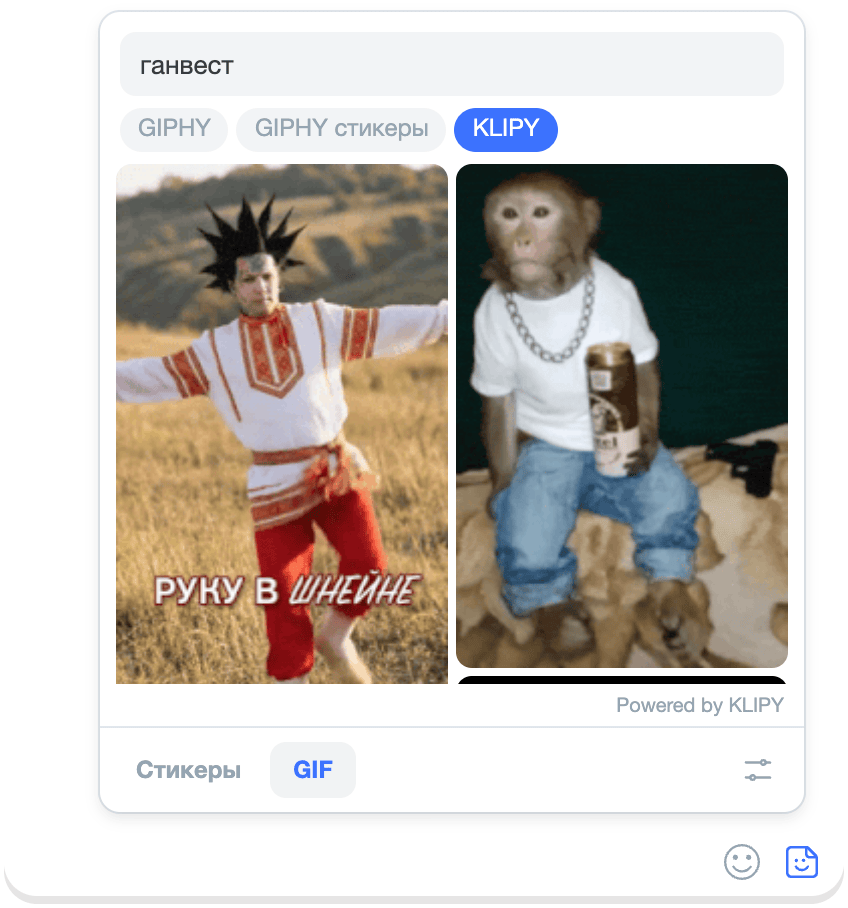

# GIF keys

KLIPY search works right away — on the built-in amo stickers key. Your own keys are optional:

- **a GIPHY key** adds the “GIPHY” and “GIPHY stickers” sources;
- **your own KLIPY key** is needed if the built-in one is unavailable — an error in the “GIFs” mode will tell you.

The keys are free, stored only in your browser, and each goes only to its own service.

## GIPHY

1. In the [GIPHY developer dashboard](https://developers.giphy.com/dashboard/), click “Create an API Key”, the type —
   “API”, not “SDK”. Any name and description will do.
2. Copy the key from the list of apps.
3. In amo stickers: “Settings” → the “GIPHY API key” field. The key saves on its own.

When you leave the field, the key is checked with a request to the service, and the result is under the field. “GIPHY
rejected the key” — the key wasn’t copied in full. “Couldn’t check the key” — the service didn’t respond; the key
is saved.

You’re done when “GIPHY” and “GIPHY stickers” appear next to “KLIPY” in the “GIFs” mode:

## Your own KLIPY key {#own-klipy}

Only needed if the “GIFs” mode shows “The built-in KLIPY key is unavailable”: the built-in key is shared by everyone
and can hit its limit.

1. In the [KLIPY Partner Panel](https://partner.klipy.com/api-keys), click “Add Platform”, any name, then “Create Key”.
   A test key with the “Testing” status will do.
2. “Show key” → copy it.
3. In amo stickers: “Settings” → the “Your KLIPY API key” field.

## Request limit {#limits}

Your own free keys have 100 requests per hour (for KLIPY, the current number is in the Partner Panel), each key its own.
Requests are spent on search, loading the next page of the feed, trending GIFs and the key check; “GIPHY” and “GIPHY
stickers” share one limit.

Hit the limit — wait an hour or switch to another source. Recent GIFs are available without requests.
