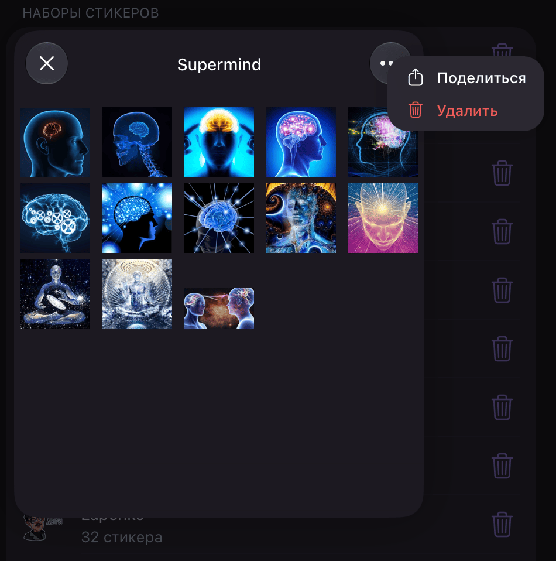
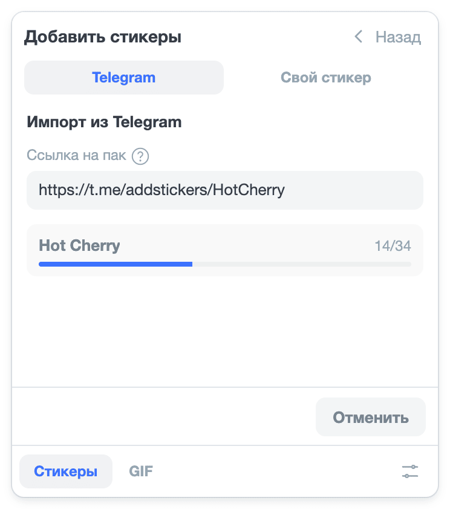
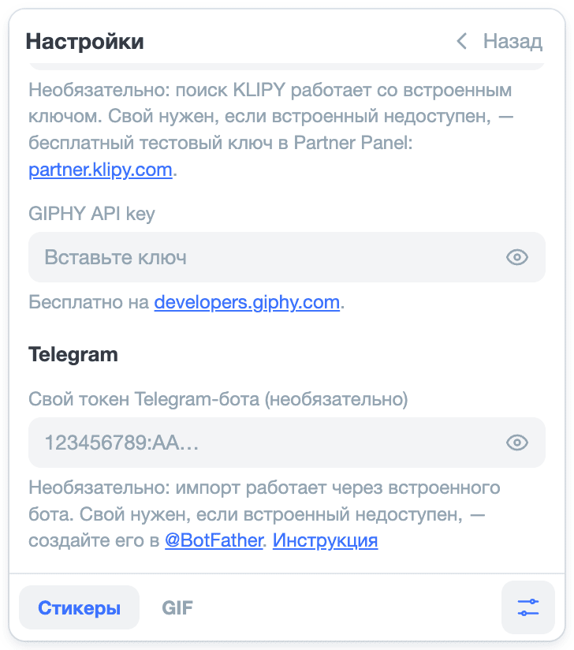

# Импорт из Telegram

Пак из Telegram добавляется целиком — статичные, анимированные (`.tgs`) и видеостикеры становятся GIF. Настраивать
ничего не нужно: пак скачивает встроенный бот amo stickers.

## 1. Скопируйте ссылку на пак {#pack-link}

**Нажмите на стикер из пака в чате Telegram, в окне пака откройте меню «⋮» → «Копировать ссылку».**

- В Telegram для macOS такого пункта нет: «Поделиться» → кнопка копирования ссылки справа вверху.
- Пак, который у вас уже добавлен: «Настройки» → «Стикеры и эмодзи» → пак → «⋮» → «Копировать ссылку».

Подойдёт `https://t.me/addstickers/Имя`, ссылка на пак эмодзи `t.me/addemoji/Имя` или одно имя пака.

## 2. Импортируйте пак {#import}

В режиме «Стикеры» нажмите «+» → «Telegram», вставьте ссылку и нажмите «Импорт».

Пак появится отдельной вкладкой. Карточка под полем покажет название и число стикеров ещё до импорта, а для пака,
который уже есть, — что импорт его обновит. С экрана можно уйти — ход импорта появится внизу панели. «Отменить»
возвращает библиотеку как было до импорта.

## Если не получилось

Ошибка — под полем ссылки или, если вы ушли с экрана, внизу панели.

- **«Встроенный бот Telegram недоступен…»** — бот упёрся в лимит или отозван. Повторите позже или заведите
  [свой бот](#own-bot).
- **«Укажите токен бота в настройках»** — сборка без встроенного бота (например, из исходников): нужен
  [свой бот](#own-bot).
- **«Не понял ссылку…»** — в поле не ссылка на пак, см. [шаг 1](#pack-link).
- **«HTTP 400 … STICKERSET_INVALID»** — пака нет. Проверьте, открывается ли ссылка в Telegram.
- **«HTTP 401 … Unauthorized»** — Telegram не принял ваш токен: скопируйте его [заново](#own-bot-token).

## Свой бот (необязательно) {#own-bot}

Нужен, только если встроенный недоступен. Бота создают один раз — добавлять в чаты и настраивать его не нужно.

::: warning Токен — секрет
С токеном кто угодно управляет ботом: не пересылайте его и не показывайте на скриншотах. amo stickers хранит токен
в браузере и отправляет только в `api.telegram.org`. Утёк — в @BotFather нажмите «Revoke» и вставьте новый.
:::

### 1. Создайте бота

Откройте [@BotFather](https://t.me/BotFather) → «Open» → «Create a New Bot». Имя — любое, имя пользователя должно
заканчиваться на `bot`. Нажмите «Create Bot». В старом интерфейсе Telegram — команда `/newbot` в чате с @BotFather.

### 2. Скопируйте токен {#own-bot-token}

На странице бота нажмите «Copy». Позже токен можно скопировать там же: @BotFather → «My bots» → бот → «Copy».

### 3. Вставьте токен в «Настройки»

Панель amo stickers → «Настройки» → поле «Свой токен Telegram-бота». Токен сохраняется сам. «Не похоже на токен бота»
под полем — токен скопирован не целиком.

Теперь импорт идёт через вашего бота.
