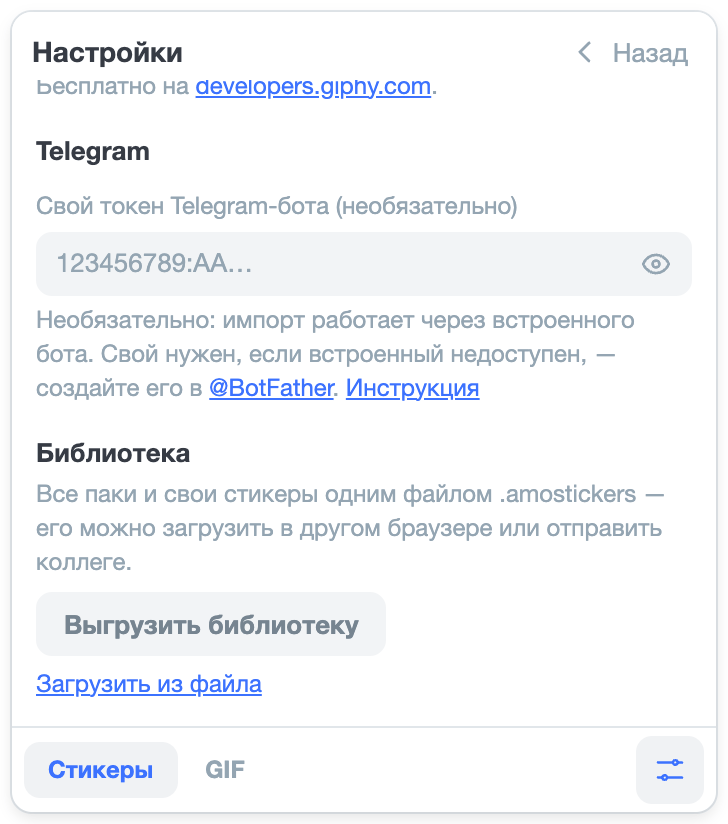
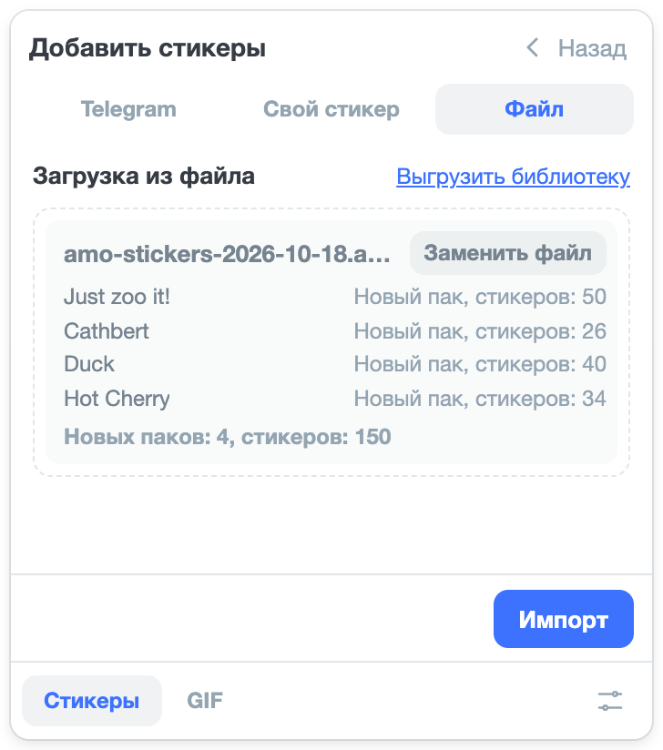

# Перенос библиотеки

Паки, свои стикеры, избранное и недавние хранятся в браузере, на сайте amo. В другом браузере или на другом компьютере
их нет — перенесите их файлом `.amostickers`: выгрузите библиотеку здесь и загрузите там.

::: warning Библиотека живёт в браузере
Очистка данных сайта amo в настройках браузера удаляет все паки, свои стикеры, избранное и недавние. Файл выгрузки —
резервная копия библиотеки: выгружайте её время от времени, и после очистки её можно будет загрузить обратно.
:::

## 1. Выгрузите библиотеку {#export}

Откройте «Настройки» — значок справа внизу панели — и в группе «Библиотека» нажмите «Выгрузить библиотеку».
Туда же ведёт ссылка «Выгрузить библиотеку» на вкладке «Файл» экрана «Добавить стикеры».

Браузер скачает файл `amo-stickers-<дата>.amostickers` — как обычное скачивание, в папку загрузок. В нём все паки и свои
стикеры, избранное, недавние стикеры и GIF. Ход выгрузки виден рядом с кнопкой, в конце — «Библиотека выгружена:
стикеров N», а у библиотеки без стикеров, с одними GIF, — «Библиотека выгружена». Пока выгружать нечего — нет
ни стикеров, ни избранного, ни недавних GIF, — кнопка недоступна.

Файл библиотеки — для переноса своей библиотеки: в нём ваше избранное и история отправок. Поделиться стикерами — [файлом
пака](#share-pack).

## 2. Загрузите файл на новом месте {#import}

[Установите amo stickers](../install/) в новом браузере, откройте amo и нажмите «+» → «Файл» — или ссылку «Загрузить
из файла» под кнопкой выгрузки в «Настройках». Нажмите «Выбрать файл» или перетащите файл в зону. Подойдёт и `.zip` —
если файл переименовали или распаковали и запаковали архиватором.

Карточка встанет на место зоны и покажет паки файла: сколько стикеров в новом паке и сколько добавится в пак, который
уже есть, — а под ними, сколько добавится в избранное и в недавние. Длинный список паков прокручивается внутри карточки,
а другой файл выбирает «Заменить файл» в её углу. Нажмите «Импорт». Сначала идёт проверка стикеров — её останавливает
«Отменить», затем «Запись…» — её не прервать. В конце — «Добавлено стикеров: N», и лента встаёт к первому разделу,
в который добавились стикеры, в том числе к «Избранному» или «Недавним». Если стикеров не добавилось, а избранное
или недавние добавились, в конце — «Избранное и недавние добавлены».

С экрана можно уйти — выбранный файл и карточка останутся, а ход импорта появится внизу панели.

## Что делает загрузка {#merge}

- **Только добавляет.** Ваши паки и стикеры остаются как есть: в пак, который уже есть, добавляются только стикеры,
  которых в нём нет, — в конец. Где встанут новые паки — в [частых вопросах](../faq#pack-order).
- **Свои стикеры** из файла, в том числе из чужого, попадают в «Мои стикеры».
- **Избранное и недавние** из файла добавляются к вашим: ваше не убирается, а то, что уже в избранном, не меняется.
  В недавних остаются 40 самых недавних стикеров и 40 GIF, а у того, что есть и там, и там, — более позднее время
  отправки.
- **Повторная загрузка** того же файла дублей не создаёт — ни в паках, ни в избранном, ни в недавних: карточка сообщит
  «Всё из этого файла уже в библиотеке».
- **Подписи и эмодзи** сохраняются, а у пака из Telegram работает «Копировать ссылку».
- **Отмена, ошибка или нехватка места** оставляют библиотеку, избранное и недавние как были.

## Поделиться паком {#share-pack}

Меню «…» в заголовке пака → «Выгрузить пак». Файл называется по названию пака, например `Котики.amostickers`, —
отправьте его коллеге, а он загрузит его так же: «+» → «Файл». У «Моих стикеров» в меню только этот пункт.

Пак из Telegram проще передать ссылкой — «Копировать ссылку» в том же меню, а файл подойдёт для своих стикеров
и для пака, который в Telegram уже удалён.

Делиться стикерами — файлом пака: в нём только стикеры пака, без избранного и недавних. Файл библиотеки — личный: тот,
кому вы его отправите, увидит ваше избранное и историю отправок.

## Что в файле {#contents}

Стикеры, их эмодзи и подписи, названия паков и имена наборов Telegram. В выгрузке всей библиотеки — ещё время добавления
и последней отправки из каждого пака (на новом месте паки встанут в том же порядке), избранное и недавние стикеры и GIF
со временем отправки. В выгрузке пака нет ни избранного, ни недавних. Ключей GIF, токена бота и настроек нет ни в каком
файле. Подробнее — в [политике конфиденциальности](../privacy#export-file).

## Если не получилось {#errors}

Ошибка загрузки — под зоной, а если вы ушли с экрана, — ещё и внизу панели. Ошибка выгрузки — внизу панели.

- **«Это не файл amo stickers»** — выбран другой файл или архив.
- **«Файл повреждён или скачан не до конца»** — скачайте файл заново или выгрузите библиотеку ещё раз.
- **«Файл выгружен более новой версией amo stickers»** — [обновите amo stickers](../update).
- **«Не хватает места в браузере»** — освободите место на диске и нажмите «Импорт» снова.
- **«Библиотека не помещается в один файл»** — в файл входит до 10 000 стикеров, и он меньше 4 ГБ. Выгрузите паки
  по одному из меню «…».
