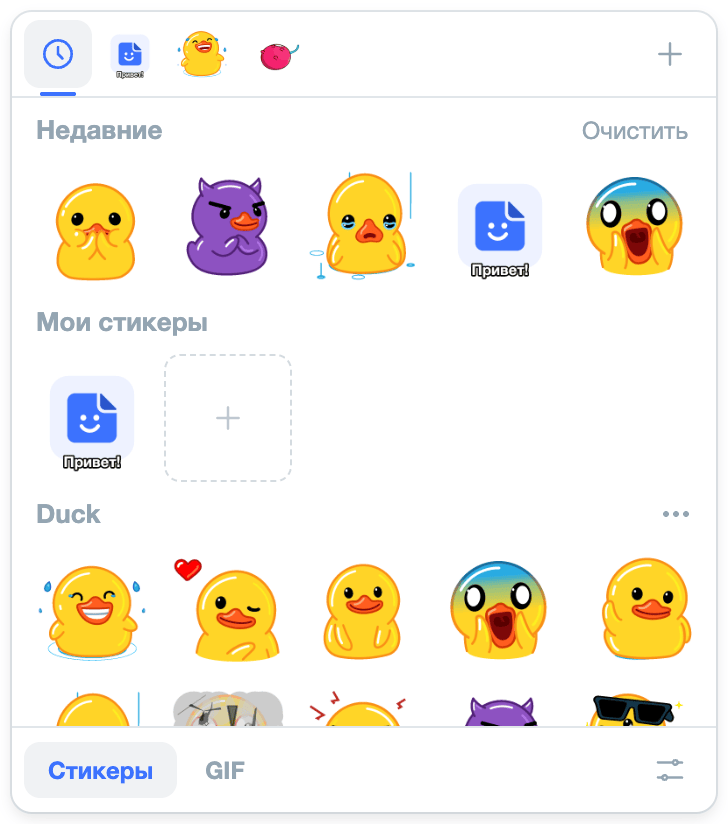
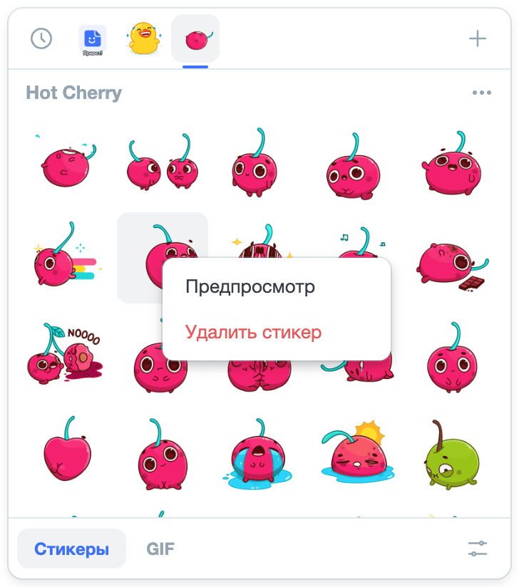
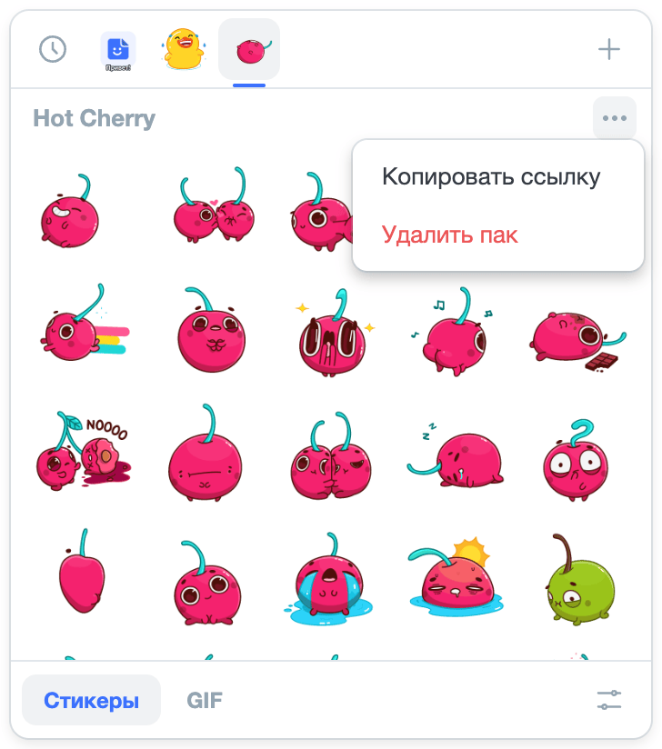

# Как пользоваться

## Панель

Кнопка стикеров — в строке ввода, рядом с эмодзи. Наведение открывает панель, клик закрепляет: тогда она закроется
только повторным кликом по кнопке, кликом мимо или Escape.

Вкладки — «Избранное», «Недавние» (до 14 последних стикеров, без избранных), «Мои стикеры» и паки из Telegram. Паки идут
от того, из которого вы отправляли последним, а только что импортированный пак встаёт первым. Отправка из «Избранного»
и «Недавних» порядок паков не меняет. Порядок обновляется при следующем открытии панели, а не под курсором.

## Отправка

Клик по стикеру или GIF — и он ушёл отдельным сообщением: текст и вложения в поле ввода остаются на месте. Если над
полем стоит плашка ответа, стикер уйдёт ответом.

Собеседник без amo stickers получит обычную GIF, с amo stickers — стикер без пузыря, как в Telegram.

## Свой стикер {#custom}

<video width="364" autoplay loop muted playsinline aria-label="Плитка «Создать стикер» → «Выбрать файл» → подпись «Привет!» → «Сохранить в „Мои стикеры“»: стикер появляется в разделе «Мои стикеры»">
  <source src="./img/usage/custom-sticker.webm" type="video/webm">
  <source src="./img/usage/custom-sticker.mp4" type="video/mp4">
</video>

Подойдёт картинка, GIF, видео или `.tgs`, файл можно и перетащить. Подпись рисуется на стикере. Стикер вписывается в 512
px, анимация — до 4 секунд, а если файл тяжелее 2 МБ, сторона уменьшается.

## GIF

Поиск KLIPY работает без ключа, [ключ GIPHY](./setup/gif-keys) добавляет источники «GIPHY» и «GIPHY стикеры».
Без запроса в ленте — избранные, недавние GIF и тренды. GIF тяжелее 2 МБ перед отправкой пережимается.

## Предпросмотр {#preview}

<video width="364" autoplay loop muted playsinline aria-label="Стикер зажат кнопкой мыши — он крупно на всю страницу; курсор с зажатой кнопкой ведут по другим стикерам, и предпросмотр меняется; кнопку отпускают — предпросмотр закрывается">
  <source src="./img/usage/preview.webm" type="video/webm">
  <source src="./img/usage/preview.mp4" type="video/mp4">
</video>

Зажмите стикер или GIF — он откроется крупно. Не отпуская кнопку, ведите курсор по ленте: предпросмотр переключается.
Отпустили — закрылся, ничего не отправилось. Если не открывается, держите курсор неподвижно. На сенсорном экране — пункт
«Предпросмотр» в меню.
Предпросмотр из меню закрывается Escape или кликом, а стрелки листают в нём стикеры и GIF.

## Избранное {#favorites}

Стикер или GIF, который нужен под рукой, добавьте в избранное — пунктом «Добавить в избранное» в [меню](#menu). Пункт
«Убрать из избранного» того же меню убирает его оттуда.

В режиме «Стикеры» раздел «Избранное» стоит первым, перед «Недавними». В режиме «GIF» избранные GIF — над недавними,
пока строка поиска пуста. Последний добавленный — в начале раздела.

Отправки избранное не вытесняют, а очистка недавних и удаление пака его не трогают: стикер из удалённого пака остаётся
в избранном и отправляется. В «Недавних» избранное не повторяется — там до 14 последних стикеров кроме избранных.

## Меню и удаление {#menu}

<!-- скрин: img/usage/menu-favorite.png — меню стикера пака: «Предпросмотр», «Добавить в избранное», «Удалить стикер»; заменит menu.png -->

Меню стикера или GIF — правый клик, клавиша меню или Shift+F10. В нём «Предпросмотр», «Добавить в избранное» или «Убрать
из избранного», в разделах паков и «Моих стикеров» — ещё «Удалить стикер», в недавних — «Убрать из недавних».
У заголовка пака — «…»: «Копировать ссылку» даёт ссылку для [импорта](./setup/telegram) на другом устройстве.
У заголовка недавних — «Очистить».

Удаление и очистку подтвердите повторным нажатием за пару секунд — первое меняет надпись на «Точно удалить?».
